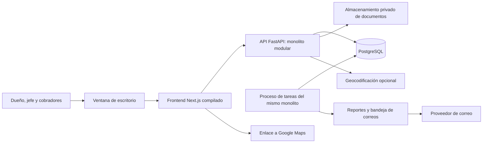
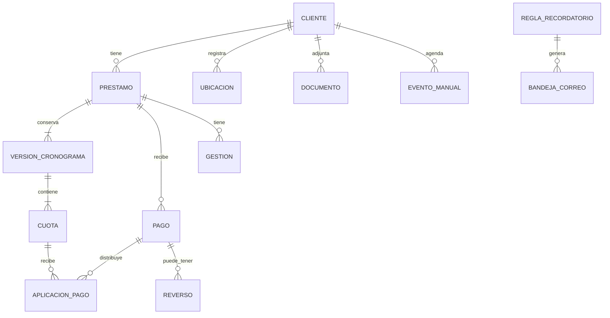

# Sistema de cobranzas de préstamos — plan de arquitectura

Fecha: 12 de octubre de 2026. Estado: arquitectura del backend propuesta; frontend de presentación implementado en `../frontend/`. Alcance efectivo en [la entrega del frontend](06-frontend-implementado.md).

Detalle de planificación: [diagramas funcionales](03-flujos-funcionales.md), [acciones y paneles del frontend](04-plan-detallado-frontend.md) y [escenarios de presentación](05-escenarios-presentacion.md). Para aprobación, desembolso, reversos y estados, prevalece el desglose de esos documentos.

## 1. Alcance acordado

Aplicación para gestionar **préstamos con cuotas e intereses**, registrar cobranzas y organizar el trabajo del dueño, jefe de cobranza y cobradores. Primero se construirá una presentación interactiva del frontend en **Next.js**, con información ficticia. Después se implementará el sistema real en **Python, FastAPI y PostgreSQL**, como monolito modular.

El frontend incluirá calendario, búsqueda de clientes, expedientes, préstamos, pagos, documentos, ubicaciones, recordatorios, reportes y configuración. La apariencia será minimalista, inspirada en la suavidad de ChatGPT, con temas **Blanco, Negro y Navi (azul marino)**. Los formularios y detalles se abrirán en paneles modales desde la derecha, con el fondo desenfocado.

Supuestos iniciales editables: Perú, moneda PEN, interfaz en español, zona horaria America/Lima, una organización y préstamos principalmente mensuales. La selección de préstamos con cuotas e intereses y el uso de Next.js sí fueron confirmados por el usuario. La moneda, país operativo y periodicidades finales todavía son supuestos.

## 2. Qué significa escritorio en este proyecto

FastAPI será la capa de aplicación y API; la ventana de escritorio necesita una envoltura. Se propone **pywebview**, para mantener ese arranque en Python y mostrar el frontend compilado dentro de una ventana de Windows. Su documentación describe el uso de una interfaz web con lógica Python; la integración concreta se probará al empaquetar. [Arquitectura de pywebview](https://pywebview.flowrl.com/guide/architecture.html).

El frontend de Next.js utilizará exportación estática. Durante el desarrollo se usará el entorno de Next.js; la aplicación instalada servirá los archivos compilados desde FastAPI. Así, el sistema real podrá funcionar con un backend Python, sin añadir un segundo backend Node.js. La exportación estática tiene restricciones: no se usarán Server Actions, renderizado dinámico en servidor ni rutas dependientes de peticiones. [Exportación estática de Next.js](https://nextjs.org/docs/app/guides/static-exports).

### Topología propuesta



La API y el proceso de tareas compartirán repositorio, módulos de negocio, versiones y base de datos. Ejecutarlos en procesos diferentes no convierte la aplicación en microservicios.

Para varios usuarios, se recomienda instalar FastAPI, PostgreSQL, el almacenamiento y las tareas en un servidor central o equipo dedicado. Las ventanas de escritorio se conectarán a ese servicio. Para un solo usuario, puede instalarse todo en su PC. **Si ese PC se apaga, los recordatorios no podrán ejecutarse hasta volver a encenderlo.** El requisito de enviar correos con la aplicación cerrada requiere un servicio que continúe encendido.

En producción se gestionarán inicio automático, reinicios y disponibilidad. FastAPI permite varios procesos de atención; por eso el planificador no debe iniciarse una vez por cada proceso de la API. [Despliegue de FastAPI](https://fastapi.tiangolo.com/deployment/server-workers/).

## 3. Módulos del monolito

| Módulo | Responsabilidad | Reglas principales |
|---|---|---|
| Identidad y permisos | Usuarios, sesiones, roles y carteras asignadas | El backend comprueba permisos en cada operación |
| Clientes | DNI, nombres, teléfonos, correo, dirección, referencias y etiquetas | DNI único por organización; admitir más tipos de documento en el modelo |
| Préstamos | Solicitud, aprobación, condiciones, desembolso y cierre | Las condiciones aprobadas quedan versionadas |
| Motor financiero | Tasas, simulación, cronograma, intereses y liquidación | Cálculo reproducible y precisión decimal |
| Pagos y cobranzas | Abonos, aplicación a cuotas, comprobantes y reversos | Registro transaccional; nunca borrar un pago confirmado |
| Gestión de cobranza | Visitas, llamadas, notas y promesas de pago | Una promesa no modifica el vencimiento contractual |
| Calendario | Vencimientos, visitas, promesas y tareas | Cuotas derivadas del cronograma; actividades manuales editables |
| Documentos | Fotos de fachada, contratos, DNI y comprobantes | Archivos privados vinculados a su expediente |
| Ubicaciones | Dirección, coordenadas, origen y confirmación del punto | Una foto no equivale a una ubicación verificada |
| Recordatorios | Reglas de aviso, resumen al dueño y registro de envío | Evitar avisar por cuotas ya pagadas; controlar duplicados |
| Reportes | Cartera, vencimientos, mora, recaudación y cierres | Distinguir capital, interés, mora y saldo exigible |
| Configuración y auditoría | Parámetros, tasas, destinatarios, eventos y respaldos | Registrar autor, fecha, motivo y versión afectada |

### Organización del código futuro

```text
frontend/                       Next.js: interfaz y adaptador de datos
backend/
  app/
    main.py                     composición de la aplicación
    core/                       configuración, seguridad y conexión a BD
    modules/
      clients/
      loans/
      finance/
      payments/
      collections/
      calendar/
      documents/
      locations/
      reminders/
      reports/
      identity/
      audit/
    jobs/                       arranque del proceso de tareas
    shared/                     dinero, fechas e identificadores
  migrations/                   cambios de esquema
  tests/                        verificaciones del sistema real
desktop/                        arranque y empaquetado Windows
docs/                           arquitectura, UX y reglas aprobadas
```

Cada módulo tendrá entrada API, casos de uso, reglas de dominio y acceso a datos. Los casos de uso coordinarán transacciones; las rutas HTTP no concentrarán cálculos financieros. El motor financiero podrá probarse sin abrir una ventana ni levantar FastAPI.

Herramientas previstas para la implementación: SQLAlchemy y psycopg para acceso a PostgreSQL, Alembic para migraciones, Pydantic para contratos de entrada y salida, y Uvicorn para ejecutar la API. Se fijarán versiones compatibles al implementar.

## 4. Modelo de datos

| Entidad | Datos esenciales |
|---|---|
| Organización | Nombre, moneda base, zona horaria y datos del dueño |
| Usuario / asignación | Rol, estado y cartera de clientes accesible |
| Cliente | Documento como texto, nombres, teléfonos, correo, dirección, etiquetas y estado |
| Ubicación | Cliente, latitud, longitud, dirección propuesta, origen, fecha y usuario de confirmación |
| Documento | Tipo, propietario, referencia privada al archivo, tamaño, MIME, hash y fecha |
| Regla de tasa / versión | Rangos de monto, plazo, tipo de tasa, vigencia y prioridad |
| Préstamo | Cliente, capital original, moneda, fecha de desembolso, estado y versión de condiciones |
| Condiciones del préstamo | Método, tasa pactada, periodicidad, base de días, cargos y política de pagos |
| Versión de cronograma | Préstamo, motivo, aprobación y vigencia |
| Cuota | Versión, número, fecha de vencimiento, capital e interés previstos |
| Pago | Préstamo, importe, fecha efectiva, método, referencia, estado y clave de idempotencia |
| Aplicación de pago | Pago, cuota y desglose de capital, interés y mora |
| Reverso | Pago original, importe, motivo, autorización y fecha |
| Movimiento de crédito / devolución | Cliente, moneda, origen del excedente, importe, aplicaciones y devoluciones; clave de operación |
| Vinculación de promesa y pago | Promesa, pago e importe aplicado al compromiso; control de asignación duplicada |
| Gestión / promesa | Cliente, préstamo, tipo, resultado, nota, importe prometido y fecha acordada |
| Evento manual | Visita o tarea, inicio, fin, responsable, estado y relación con cliente/préstamo |
| Regla de recordatorio | Destinatarios, anticipación, hora, frecuencia y contenido |
| Bandeja de correo | Clave de generación, estado, intentos, contenido y referencia del proveedor |
| Auditoría | Acción, entidad, autor, motivo, fecha y versión, sin exponer secretos |



Los importes se almacenarán como `NUMERIC` en PostgreSQL y se calcularán con `Decimal` en Python. Las tasas necesitarán más decimales que los importes que se muestran. PostgreSQL recomienda `numeric` para cantidades que requieren exactitud, incluidos importes monetarios. [Tipos numéricos](https://www.postgresql.org/docs/current/datatype-numeric.html).

Los vencimientos serán fechas de negocio, sin conversión horaria. Pagos, visitas y auditoría tendrán instantes con zona horaria. Un mismo cliente podrá tener varios préstamos, incluso con distintas tasas. La búsqueda contemplará nombre sin distinguir acentos, documento, teléfono y código de préstamo. Se indexarán documentos, nombres, fechas de vencimiento y relaciones.

## 5. Estados y consistencia

Préstamo: borrador → aprobado → desembolsado/activo → liquidado. Un borrador o aprobado sin desembolso puede cancelarse; un préstamo liquidado conserva todo su historial. La interfaz tendrá acciones diferenciadas para aprobar condiciones y registrar desembolso realizado. Un reverso autorizado puede reabrir un préstamo liquidado si restaura obligaciones.

La condición de **al día, vence hoy o en mora** se calculará a partir de cuotas y pagos, separada del ciclo de vida del préstamo. La clasificación de un cliente será un resumen de todos sus préstamos; no sustituirá sus saldos individuales.

Cuota: pendiente → parcialmente pagada → pagada. Vencida es una condición calculada cuando queda importe exigible después de la fecha límite. Pago: registrado o reversado. Evento manual: pendiente, completado o cancelado. Promesa: pendiente, cumplida, incumplida o cancelada.

Registrar un pago, distribuirlo y actualizar sus efectos se hará en una sola transacción. Se bloquearán los registros financieros necesarios durante pagos concurrentes. Repetir una petición con la misma clave de idempotencia no creará dos pagos. El saldo resultará de movimientos y versiones de cronograma, con controles de conciliación.

## 6. Intereses y cronogramas

No existe una sola «fórmula bancaria». El producto debe definir método de amortización, tipo de tasa, periodicidad, calendario y conceptos cobrados. La cuota puede incluir capital, intereses y otros conceptos; la TCEA refleja costos adicionales a la tasa de interés. [Orientación de la SBS sobre créditos](https://www.sbs.gob.pe/usuarios/aprende-con-la-sbs/aprende-sobre-creditos).

### Propuesta para la primera versión

Método principal: **cuota fija, sistema francés**, con tasa efectiva anual (TEA) y cuotas mensuales de períodos convencionales iguales. Método alternativo: interés simple anual, identificado como tal. Los seguros, comisiones y mora estarán en cero en la demo inicial, salvo escenario ficticio expresamente etiquetado.

Para TEA expresada como decimal y períodos mensuales iguales:

```text
i = (1 + TEA)^(1/12) - 1
cuota = P × i / (1 - (1 + i)^(-n))
interés del período = saldo de capital anterior × i
amortización = cuota - interés del período
saldo nuevo = saldo anterior - amortización
si i = 0: cuota = P / n
```

`P` es el capital y `n` el número de cuotas. Una tasa expresada en porcentaje se convierte a decimal antes de calcular. La TEA no se divide simplemente entre doce.

Para un período efectivo de `d` días, una tasa efectiva puede convertirse con `i_d = (1 + TEA)^(d/base) - 1`. El uso de factores efectivos por días aparece en documentación bancaria; la base y el tratamiento de cada producto deben acordarse. [Fórmulas publicadas por BBVA Perú](https://www.bbva.pe/content/dam/public-web/peru/documents/personas/formula-para-liquidacion-de-intereses_prest_sin_Desg.pdf).

La fórmula de cuota fija anterior presupone períodos iguales. Para fechas irregulares, primera cuota especial o cronogramas por días reales se utilizará un cálculo específico que respete cada intervalo. No se reutilizará automáticamente la tasa mensual. La demo priorizará el cronograma mensual; semanal, cada 15 días y diario quedan para la ampliación del motor, después de definir sus convenciones.

Para interés simple: `I = P × r_simple_anual × d/base`. No se presentará esa tasa nominal simple como TEA. Cada simulación mostrará capital, tipo de tasa, número de cuotas, interés total, cuota, fechas y total previsto, con capital e interés separados.

### Tasas por monto y cliente

Se propondrá una tabla de reglas: rango de capital, plazo, método y tasa. Se elegirá una regla vigente, sin rangos solapados ambiguos. El dueño podrá autorizar una tasa individual, con motivo registrado. Se guardará una copia de las condiciones al aprobar el préstamo: modificar la tabla después no alterará préstamos existentes.

La mora se configurará por separado, con base de cálculo, días de gracia si corresponde y fecha de corte. Antes del uso real se validarán tasas, cargos y límites aplicables al negocio y país. El software no asumirá que toda tasa configurable es aplicable ni copiará condiciones bancarias completas.

### Pagos y ajustes

Se soportarán pago total de cuota, pago parcial, pago a varias cuotas, prepago a capital y liquidación anticipada. Un excedente tendrá destino explícito: cuotas futuras, prepago o saldo a favor; nunca desaparecerá. Para prepago se mostrará la elección entre reducir cuota o plazo según las reglas acordadas.

El orden de aplicación entre conceptos quedará definido y versionado en la política del préstamo. La demo utilizará interés vencido y luego capital de las cuotas exigibles, con mora desactivada. La liquidación anticipada utilizará capital pendiente e importes devengados aplicables a la fecha, sin confundirlos con todos los intereses futuros del cronograma.

Reprogramar generará una nueva versión, mostrando antes y después y conservando cuotas, pagos y condiciones históricas. Reversar un pago requerirá motivo y permiso y generará movimientos compensatorios. Se redondearán los importes visibles a centavos y se ajustará el último pago para cerrar el saldo; la política exacta de redondeo será uniforme.

## 7. Calendario integrado

Vistas: mes, semana, día y agenda. Filtros: responsable, cliente, tipo de evento y estado. Cuotas como eventos de día completo; visitas y tareas con horario. La zona de negocio será America/Lima.

Los vencimientos se derivarán de las cuotas del cronograma vigente, sin mantener una segunda fecha editable en el calendario. Las visitas serán eventos manuales. Las promesas se derivarán de las gestiones. Un pago actualizará calendario, expediente, cobranza y reportes en conjunto.

Al hacer clic en un evento se abrirá su panel derecho. Se podrá registrar un pago, consultar el préstamo, completar una visita o gestionar una promesa. Arrastrar una visita propondrá cambiar su horario; **arrastrar una cuota estará deshabilitado**. El botón «Reprogramar cuota» llevará al flujo financiero autorizado. Cambiar una promesa no cambia el contrato.

## 8. Fotos de casa y Google Maps

Las APIs revisadas de Google Maps geocodifican direcciones o coordenadas. Street View permite consultar imágenes cercanas a una ubicación conocida; no ofrece en esas APIs una búsqueda inversa que reciba cualquier foto de fachada y garantice la dirección exacta. Esta es una conclusión del alcance documentado de esas APIs, no una promesa de reconocimiento visual. [Geocodificación](https://developers.google.com/maps/documentation/geocoding/start-v4), [Street View](https://developers.google.com/maps/documentation/streetview/metadata).

Flujo propuesto:

1. Cargar la foto como referencia del expediente.
2. Leer coordenadas GPS de sus metadatos si existen, o ingresar dirección y referencias; en el sistema real también se podrá capturar GPS durante una visita desde un dispositivo autorizado.
3. Proponer un punto a partir de esos datos, dejando visible su origen.
4. Mostrar foto, dirección y punto para que el usuario lo confirme o corrija.
5. Guardar coordenadas confirmadas, usuario y fecha; generar el enlace a Google Maps.

Las coordenadas de una foto pueden corresponder al lugar donde se tomó, y muchos archivos no conservan GPS. La geocodificación tampoco garantiza la puerta exacta. Sin confirmación se mostrará «Ubicación pendiente» o «Ubicación aproximada».

El enlace se puede construir con Maps URLs a partir de una dirección o coordenadas; abrir estos enlaces no requiere una clave de API. La geocodificación integrada y Street View sí son integraciones distintas que deberán configurarse. [Maps URLs](https://developers.google.com/maps/documentation/urls/get-started).

En la presentación el mapa y la propuesta de ubicación se simularán de manera identificable. El botón «Abrir Google Maps» podrá abrir un enlace construido con las coordenadas ficticias seleccionadas. No se mostrará «casa encontrada» después de cargar una foto sin haber obtenido evidencia.

## 9. Recordatorios y correo al dueño

Se proponen avisos a 7, 3 y 1 día del vencimiento, vencimientos de hoy y resumen de mora. Son valores de demo ajustables. El resumen al dueño tendrá frecuencia diaria y un cierre semanal opcional; el correo y la hora reales se configurarán posteriormente.

El reporte incluirá cliente, préstamo, cuota, vencimiento, importe exigible, atraso, responsable y próximo compromiso. Se agrupará por moneda, y distinguirá capital pendiente de cuotas próximas y vencidas. Los adjuntos sensibles no se enviarán automáticamente.

El proceso de tareas consultará cuotas vigentes y promesas, excluirá lo pagado y generará una bandeja persistida en PostgreSQL. Una clave única por regla, destinatario, período y objeto evitará generar avisos duplicados. Antes de despachar se comprobará otra vez el estado de la deuda.

Estados: pendiente, en proceso, aceptado por proveedor, fallido, omitido y resultado desconocido. Habrá bloqueo de tareas, vencimiento del bloqueo si el proceso cae, reintentos espaciados y registro de errores. Un resultado SMTP incierto no permite garantizar exactamente un envío: se conciliará con el proveedor cuando sea posible antes de reenviar. Los correos aceptados por el proveedor no se marcarán automáticamente como leídos o entregados.

Si hubo una interrupción, el servicio reevaluará lo que siga siendo relevante al reiniciar, en lugar de enviar todos los avisos antiguos. La presentación solo mostrará reglas, vista previa, estado y un historial simulado; no enviará correos.

## 10. Roles y datos privados

| Rol | Acceso propuesto |
|---|---|
| Dueño / administrador | Toda la cartera; tasas, usuarios, reportes y aprobaciones |
| Jefe de cobranza | Supervisar y asignar cartera, gestionar cobranzas y revisar reportes; ajustes según permiso |
| Cobrador | Clientes asignados, pagos y gestiones; sin modificar tasas ni reversar pagos por defecto |
| Consulta | Leer los expedientes y reportes autorizados |

Autenticación y permisos se verificarán en FastAPI, además de los controles de interfaz. El servicio central utilizará HTTPS. La aplicación local limitará su servidor al equipo y protegerá la sesión; PostgreSQL no se expondrá directamente a los clientes de escritorio.

Los archivos se guardarán fuera del frontend público, con identificadores internos y descarga autorizada. Se validarán tamaño y tipo, se impedirán rutas suministradas por el usuario y se controlará su contenido antes de habilitar su descarga. Las credenciales de correo y mapas se guardarán en configuración protegida del servidor. Las claves públicas de mapas, si se usan, tendrán restricciones de origen y API.

Se respaldarán base de datos y archivos en conjunto y se comprobará la restauración. La auditoría cubrirá altas, cambios de condiciones, pagos, reversos, reprogramaciones, confirmaciones de ubicación y cambios de destinatarios. Los logs no incluirán documentos, contraseñas ni correos completos por defecto.

## 11. Contratos de API previstos

| Área | Operaciones futuras |
|---|---|
| Clientes | Buscar/paginar, crear, editar, archivar y consultar expediente |
| Préstamos | Simular, guardar borrador, aprobar, desembolsar y consultar condiciones |
| Cronograma | Consultar versión vigente, historial y propuesta de reprogramación |
| Pagos | Registrar con idempotencia, consultar comprobante, simular prepago y reversar |
| Gestiones | Registrar contacto, visita y promesa; completar o cancelar |
| Calendario | Consultar intervalo y filtros; gestionar eventos manuales |
| Documentos | Subir, listar, previsualizar y descargar con autorización |
| Ubicaciones | Proponer, corregir y confirmar |
| Recordatorios | Configurar reglas, consultar historial y solicitar vista previa |
| Reportes | Consultar cartera, mora, recaudación y generar exportaciones |

Los contratos estarán versionados bajo `/api/v1`. Dinero y tasas viajarán como cadenas decimales con moneda y tipo de tasa explícitos. Fechas de negocio usarán formato ISO de fecha; los instantes incluirán zona u offset. La búsqueda y reportes reales paginarán y filtrarán en servidor.

## 12. Fases y criterios de salida

| Fase | Entregable | Qué permite comprobar |
|---|---|---|
| 0. Plan actual | Este documento y la especificación del frontend | Cobertura de funciones, decisiones y alcance de demo |
| 1. Presentación | Next.js con mocks, temas, calendario y paneles | Todos los botones tienen comportamiento; flujos comprensibles |
| 2. Núcleo real | Clientes, préstamos, motor financiero, cuotas y pagos | Saldos exactos, concurrencia, permisos y persistencia |
| 3. Operación | Documentos, ubicaciones, gestiones, recordatorios y reportes | Archivo privado, agenda sincronizada y envío trazable |
| 4. Escritorio | Instalación Windows, servicio, respaldo y restauración | Arranque estable y operación con la ventana cerrada |

Verificaciones necesarias al implementar el núcleo: tasa cero, redondeo final, meses cortos, pagos parciales, pagos repetidos, pagos concurrentes, prepago, reverso, nuevas versiones de cronograma, permisos por cartera y recuperación del proceso de recordatorios. Cada prueba comprobará una regla de negocio, no solo la estructura del código.

Antes de producción deben quedar definidas: entidad/país operativo, tasas aplicables, política de mora, imputación de pagos, fechas irregulares, comprobantes, retención documental, correo real del dueño y alojamiento. Estas decisiones no bloquean la presentación con datos ficticios.
