# Diagramas funcionales — ciclos del backend y consecuencias en el frontend

Fecha: 12 de octubre de 2026. Etapa: planificación; estos diagramas no representan un backend implementado.

Este documento detalla la [arquitectura](01-arquitectura.md) y alimenta el [plan de acciones del frontend](04-plan-detallado-frontend.md). Los flujos describen el sistema real; la presentación de Next.js reproducirá sus respuestas con datos ficticios.

## Convenciones y decisiones de la propuesta

- Rectángulo: acción o procesamiento. Rombo: decisión. Nodo redondeado: entrada o resultado. Los caminos negativos indican cómo recuperarse.
- F00–F16 identifican flujos. A-* identifica acciones del frontend; P-* identifica paneles. Los identificadores conectan los documentos.
- Se proponen cuotas mensuales, moneda PEN y zona America/Lima. El dueño aprueba condiciones, desembolsos, reversos y reprogramaciones; otros roles solo podrán hacerlo si reciben ese permiso.
- Aprobar un préstamo y registrar la entrega del dinero son operaciones diferentes. Registrar un desembolso o un pago no ejecuta una transferencia bancaria.
- La ubicación de una casa necesita confirmación. Un préstamo puede existir con ubicación pendiente; el dato se destaca para organizar visitas.
- Un pago confirmado no se edita ni se borra. Se reversa y, si corresponde, se registra uno nuevo.
- Una promesa de pago modifica la agenda de gestión; una reprogramación modifica condiciones financieras.
- Reprogramación y prepago conservan versiones. Un reverso de un pago anterior a una reprogramación requiere revisión de esa relación; no se aplicará una restauración automática incorrecta.

## Mapa de funcionalidades

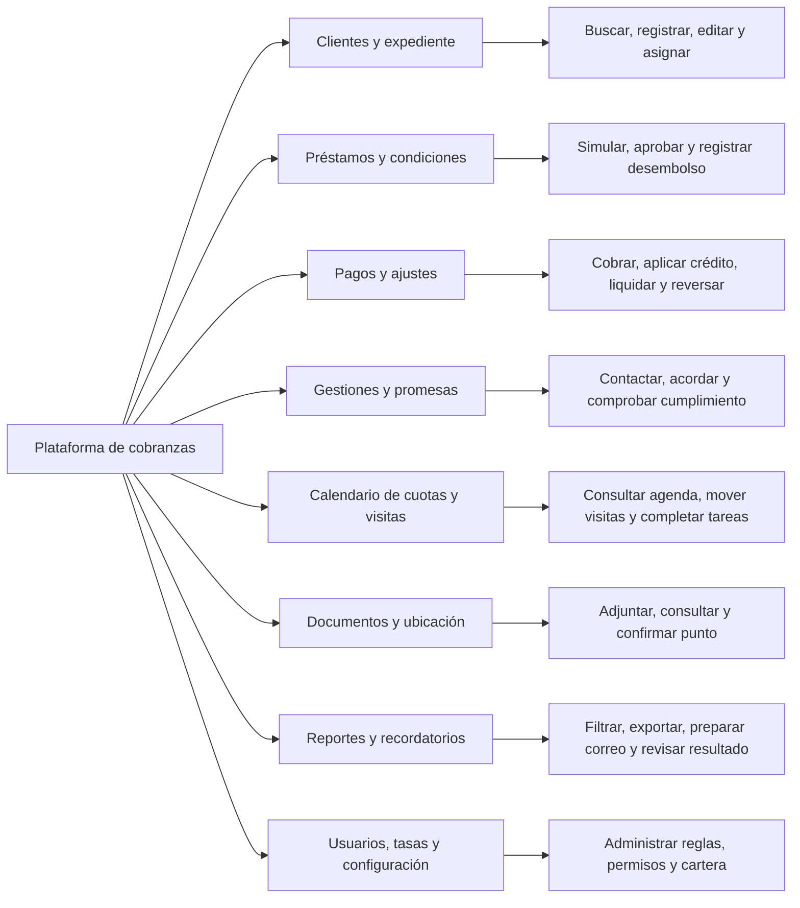

El dueño supervisa toda la operación y autoriza decisiones financieras. El jefe organiza la cartera y seguimiento según permisos. El cobrador actúa sobre clientes asignados. El perfil Consulta lee lo autorizado. Todas las funciones de dinero están relacionadas con un préstamo, y todas las actividades de gestión conservan su cliente y responsable.

## F00. Ciclo completo del negocio

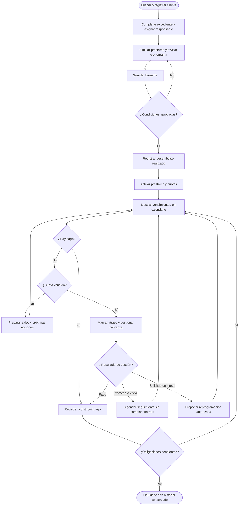

Lo que el cliente verá: alta de cliente, préstamo con borrador/aprobación/desembolso, cuotas en calendario, abonos, atraso, gestiones y cierre. Cada saldo se deriva de los mismos movimientos y condiciones.

## F01. Acceso, permisos y ejecución de una operación

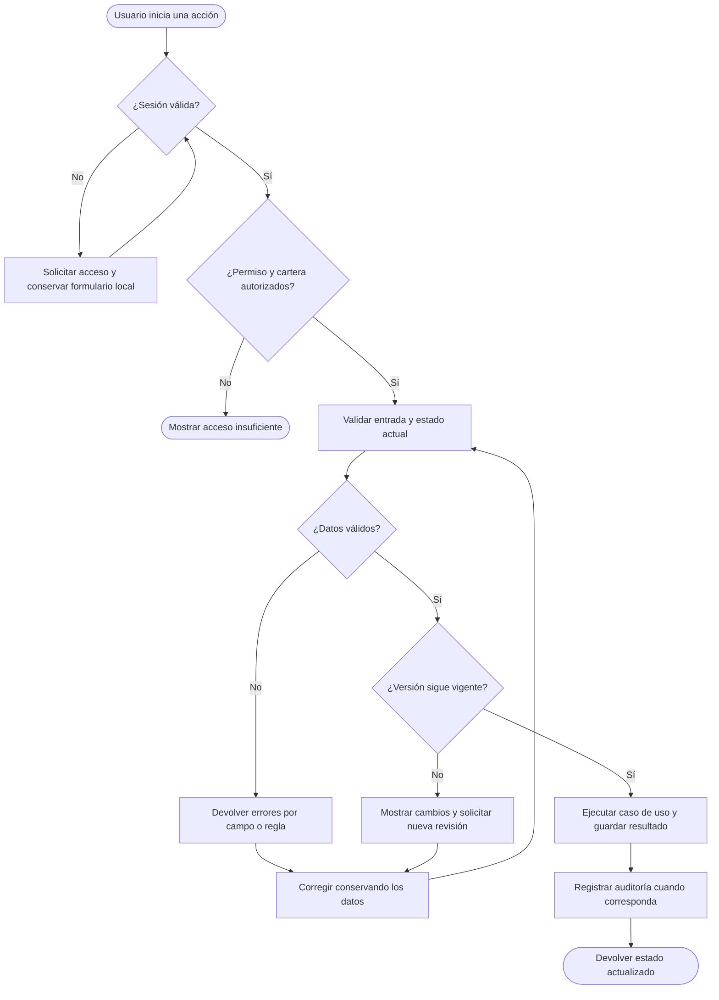

Frontend: las acciones sin permiso se ocultarán o mostrarán una explicación útil, pero la protección real estará en FastAPI. En la demo habrá selector de rol y respuesta de permiso simulado; no se pedirán contraseñas reales. Cancelar un formulario no crea una operación de negocio.

## F02. Cliente: buscar, crear, editar, asignar y archivar

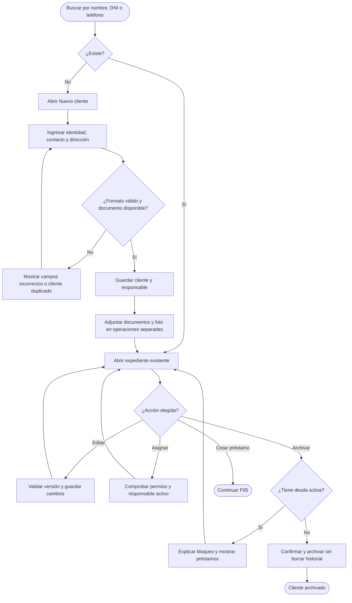

A-CLI-01 a A-CLI-07; P-CLI-ALTA, P-CLI-EXPEDIENTE y P-CLI-EDITAR. Si falla un adjunto después del alta, el cliente permanece creado y se ofrece reintentar ese archivo. El botón «Ver cliente existente» recupera el caso de documento duplicado. Un cliente archivado se puede reactivar con permiso antes de crearle otro préstamo.

## F03. Foto, dirección y punto confirmado

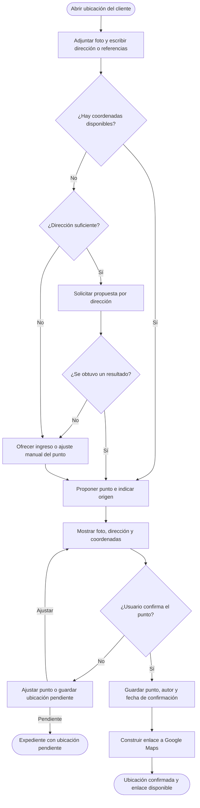

A-LOC-01 a A-LOC-05; P-LOC-UBICACION. La foto no acredita por sí misma la ubicación. En la demo se etiqueta la propuesta como simulada; «Confirmar punto» registra una decisión del usuario, no una verificación realizada por Google.

## F04. Ciclo de un documento

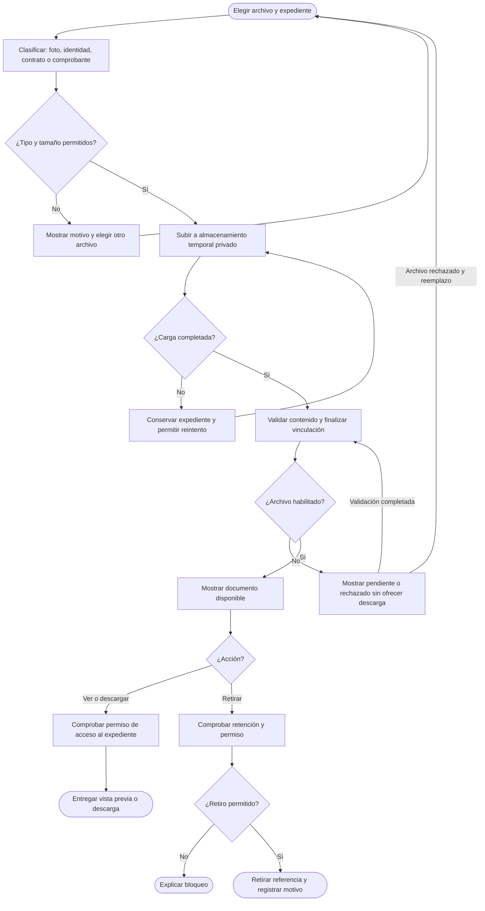

A-DOC-01 a A-DOC-05; P-DOC-CARGA y P-DOC-VISTA. El almacenamiento y la base de datos no forman una sola transacción: se usarán cargas temporales, finalización y limpieza de archivos huérfanos. En la demo los archivos son locales; no se simulará un análisis antivirus como si hubiera ocurrido.

## F05. Simulación, borrador, aprobación y desembolso

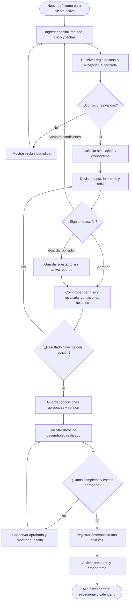

A-PRE-01 a A-PRE-09; P-PRE-NUEVO, P-PRE-APROBAR y P-PRE-DESEMBOLSO. Modificar condiciones invalida la simulación anterior. Borradores y aprobados sin desembolso no suman cartera activa ni generan avisos de cobro. Si se cambia la fecha efectiva de desembolso respecto a la aprobada, se vuelve a revisar el cronograma antes de activar.

## F06. Registro de pago total o parcial

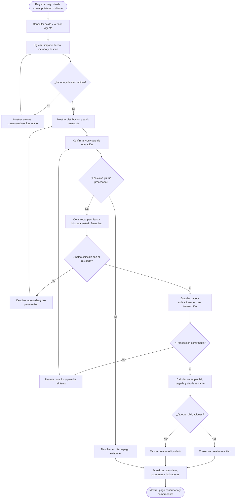

A-PAG-01 a A-PAG-06; P-PAG-REGISTRO, P-PAG-REVISION y P-PAG-COMPROBANTE. Un exceso no se acepta sin destino explícito. El comprobante se obtiene del pago ya registrado; si falla su descarga, el pago sigue válido. Si se pierde la conexión después de confirmar, se consulta/reintenta con la misma clave antes de crear otra operación.

## F07. Prepago a capital o liquidación anticipada

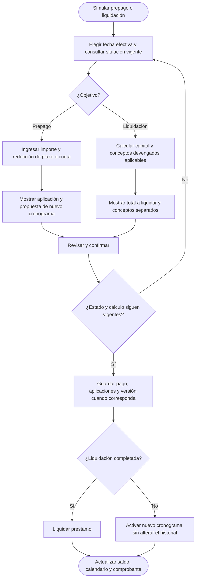

A-AJU-01 y A-AJU-02; P-AJU-PREPAGO y P-AJU-LIQUIDACION. No se cobra automáticamente todo el interés futuro previsto. La propuesta de prepago muestra qué pasa con cuotas pendientes, intereses exigibles y capital; confirmar un prepago también registra un pago, con las mismas garantías de F06.

## F08. Reverso de un pago

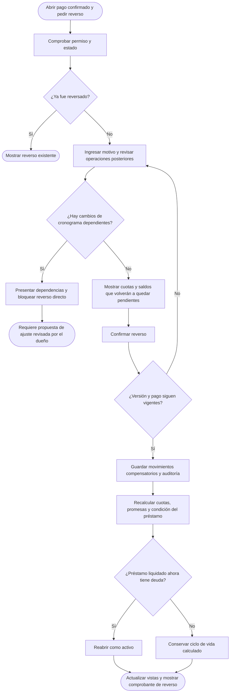

A-AJU-03; P-AJU-REVERSO. La primera versión de demo permite reversos completos sin reprogramaciones dependientes. Un caso con dependencias muestra el bloqueo y su explicación; no inventa un cálculo correctivo. El ajuste complejo se define antes de habilitarlo en el sistema real. Si se corrige un importe, el usuario registra un nuevo pago después del reverso.

## F09. Reprogramación de cuotas

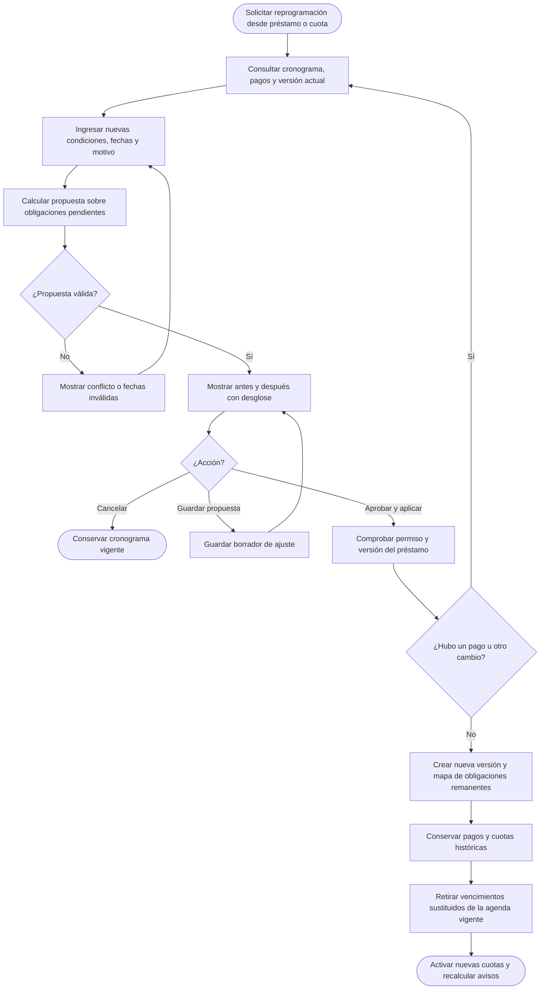

A-AJU-04 y A-AJU-05; P-AJU-REPROGRAMAR. Las cuotas pagadas no se convierten en impagadas al reprogramar. La cuota parcialmente pagada conserva sus aplicaciones y solo se trata su obligación remanente. La propuesta indicará cualquier cambio de intereses, cargos, plazo y total; nada se aplica por arrastrar un evento en el calendario.

## F10. Visita o tarea: creación, movimiento y cierre

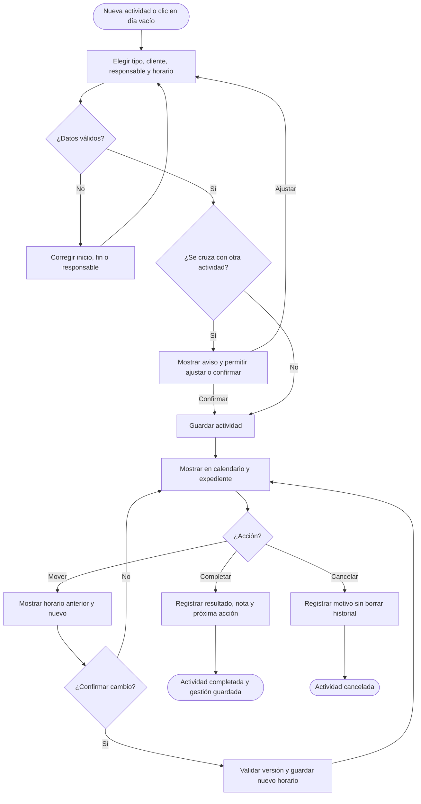

A-CAL-01 a A-CAL-06; P-CAL-EVENTO y P-CAL-RESULTADO. Un solapamiento es un aviso, no un rechazo automático, en esta propuesta. Si el nuevo horario no se confirma, el calendario restaura inmediatamente la posición anterior. Completar una visita no registra un pago; se ofrece continuar a F06.

## F11. Contacto y promesa de pago

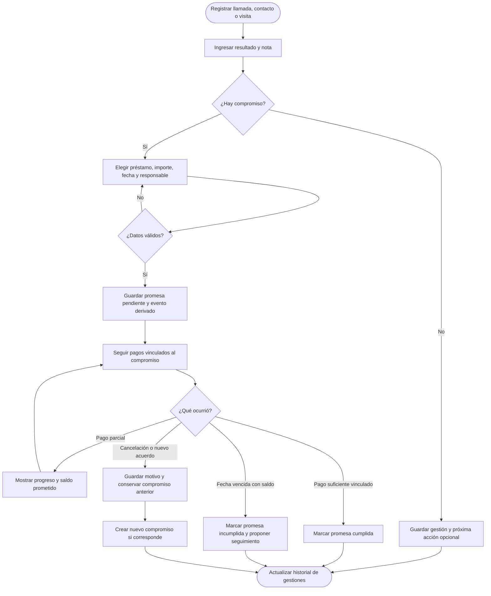

A-GES-01 a A-GES-04; P-GES-CONTACTO y P-GES-PROMESA. La promesa apunta a un préstamo concreto. Un pago solo cuenta para ella si se vincula; un mismo importe no satisface varias promesas de forma duplicada. Reversar ese pago reevalúa la promesa. La fecha contractual del préstamo no se modifica.

## F12. Recordatorio y reporte por correo al dueño

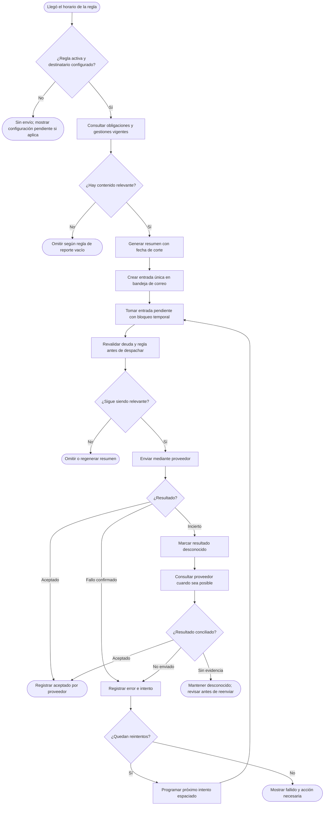

A-REC-01 a A-REC-06; P-REC-REGLA, P-REC-CORREO y P-REC-HISTORIAL. La demo usa «Simular envío» y no llama a un proveedor. El estado visible distingue «Pendiente», «Aceptado por proveedor», «Fallido» y «Resultado desconocido». Un reporte aceptado conserva el contenido que tenía al enviarse; los reportes nuevos consultan saldos actuales.

## F13. Reportes, exportación y recuperación

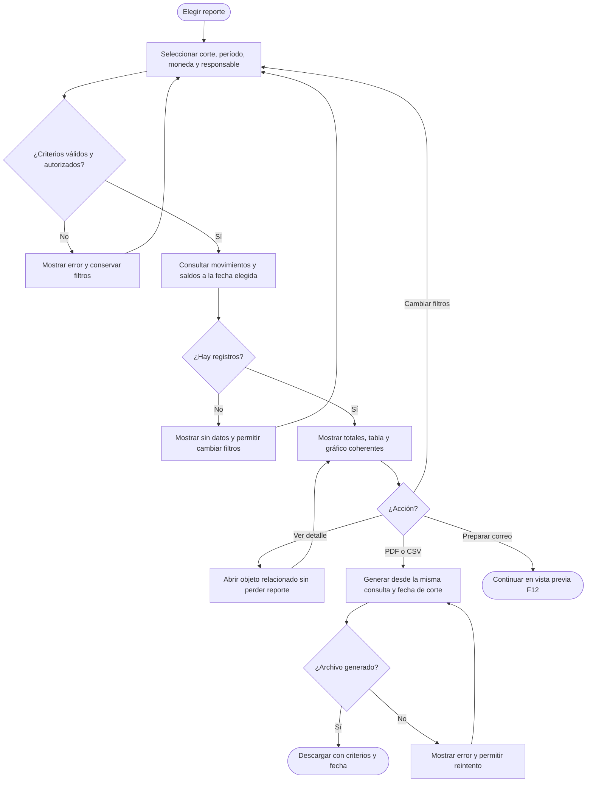

A-REP-01 a A-REP-04; P-REP-VISTA. Un reporte de mora incluye importes vencidos a su corte, no todo el capital pendiente. Un reporte histórico debe poder reconstruirse desde movimientos/versiones; en la demo ese comportamiento se limita a las fechas y operaciones disponibles.

## F14. Tasas, configuración y asignación de cartera

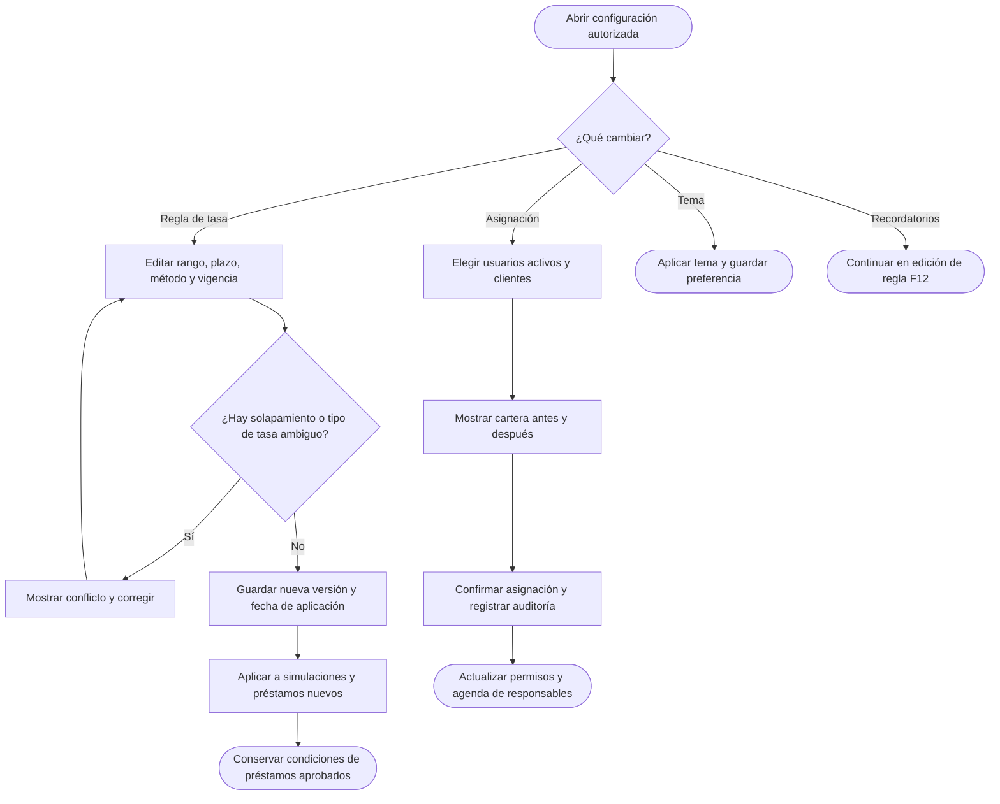

A-CFG-01 a A-CFG-05; P-CFG-TASA y P-CFG-ASIGNACION. Cambiar responsable de cartera no reescribe el autor de pagos anteriores. La asignación de visitas existentes se revisa explícitamente; no se traslada sin avisar. Desactivar un usuario no borra su historial ni deja actividades futuras sin responsable.

## F15. Fallo de conexión o respuesta incierta

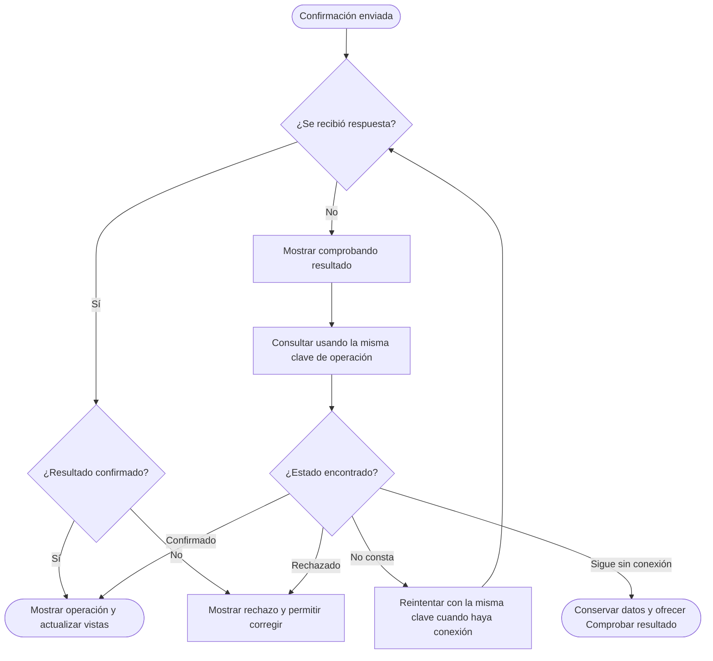

A-PAG-05 y acciones financieras equivalentes. El formulario no mostrará «No se registró» si solo falta una respuesta. No se generará otra clave al reintentar la misma operación. Este flujo se simula mediante un escenario específico, sin conectar la demo a un backend.

## F16. Excedente, saldo a favor, aplicación y devolución

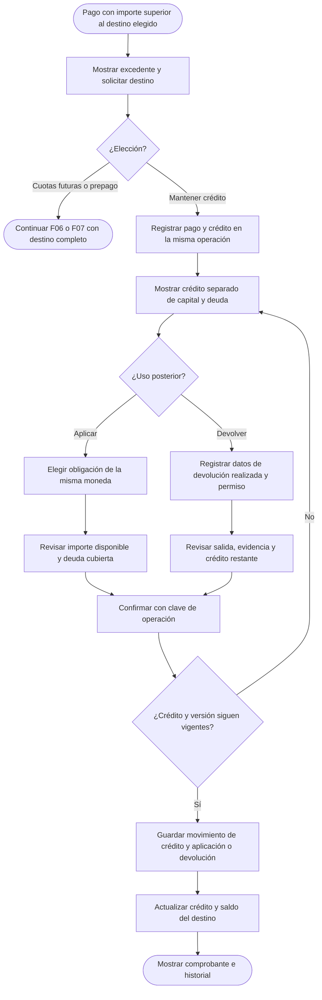

A-PAG-07 y A-PAG-08. Aplicar crédito no registra dinero nuevo recibido: ese ingreso ya quedó registrado cuando surgió el excedente. Devolver crédito registra una salida realizada, sin ejecutar transferencias. Se bloquea el crédito durante confirmaciones concurrentes y se impide aplicarlo/devolverlo dos veces. Un cliente con crédito disponible no puede archivarse hasta resolverlo.

## Estados principales del dominio

### Préstamo

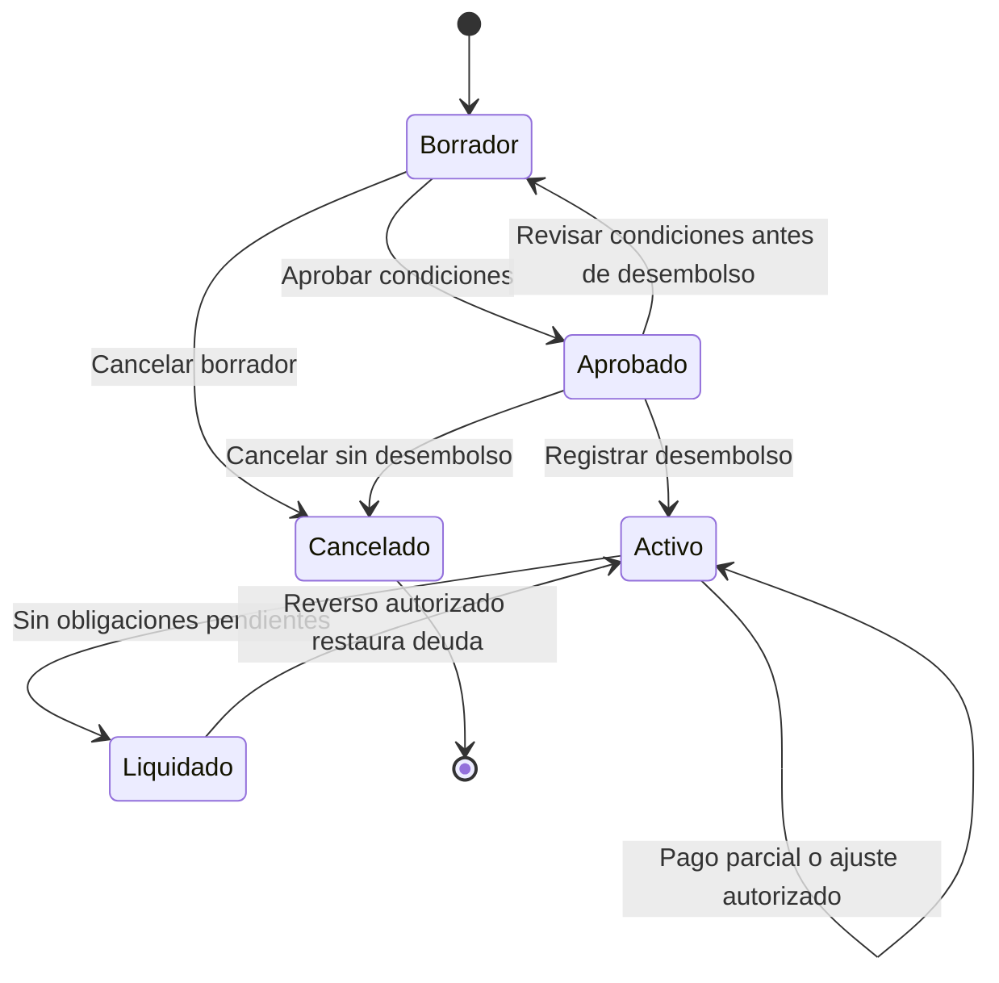

«Al día», «Vence hoy» y «En mora» son condiciones calculadas, separadas de estos estados. Un préstamo activo puede estar al día o en mora. Un préstamo cancelado no tuvo desembolso; un préstamo liquidado sí lo tuvo.

### Cuota

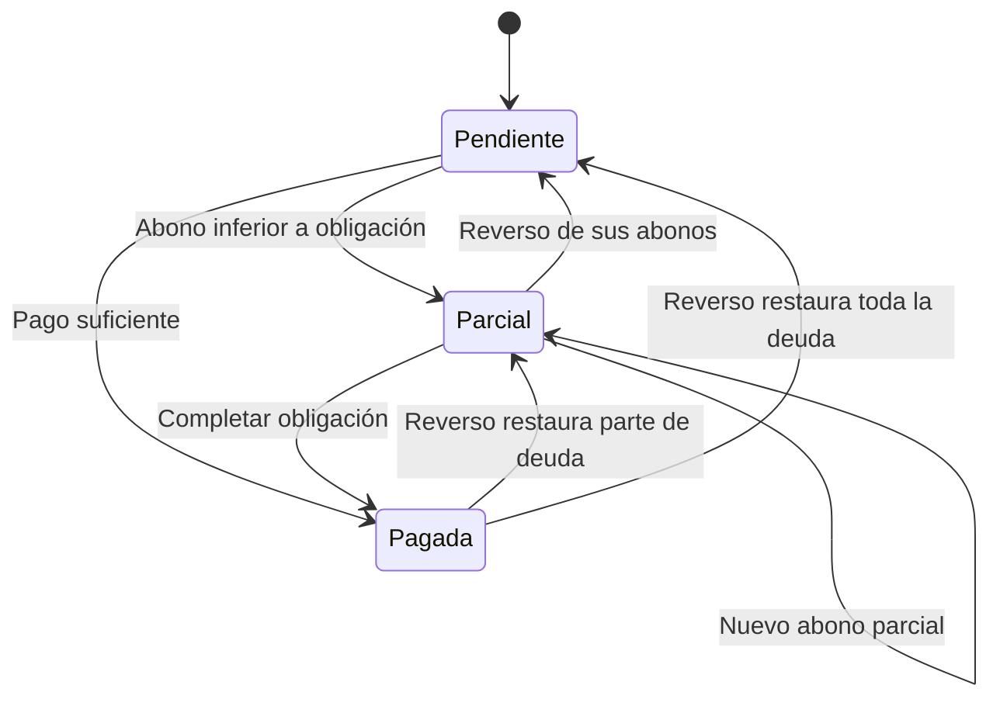

Una cuota pendiente o parcial pasa a condición «Vencida» al superar la fecha límite con saldo exigible. Reprogramada se visualiza en el historial de la versión sustituida; no se interpreta como pagada. El corte de día en America/Lima determina Hoy/Vencida.

### Promesa de pago

```mermaid
stateDiagram-v2
    [*] --> Pendiente
    Pendiente --> Cumplida: Pagos vinculados cubren compromiso
    Pendiente --> Incumplida: Fecha vencida con importe pendiente
    Pendiente --> Cancelada: Cancelación con motivo
    Incumplida --> Cumplida: Pago posterior registrado
    Cumplida --> Pendiente: Reverso restaura importe antes del límite
    Cumplida --> Incumplida: Reverso restaura importe después del límite
```

Si se cumple después del límite, se indica «Cumplida fuera de fecha» con ambos momentos conservados. Un nuevo acuerdo crea otra promesa y relaciona la anterior.

## Matriz de actualización entre pantallas

| Operación confirmada | Cliente / expediente | Préstamos y cuotas | Cobranzas | Calendario | Reportes y avisos |
|---|---|---|---|---|---|
| Crear cliente | Nueva ficha | Sin deuda | Sin movimiento | Sin cuota | Recuento de clientes |
| Guardar borrador | Préstamo borrador | No suma cartera activa | Sin obligación | Sin cuota activa | Sin aviso de cobro |
| Registrar desembolso | Préstamo activo | Capital y cuotas vigentes | Fechas exigibles | Vencimientos derivados | Cartera y próximas cuotas |
| Pago parcial | Menor capital según aplicación | Cuota parcial | Pendiente restante | Evento actualizado | Importes y reglas reevaluados |
| Pago completo | Pago visible | Cuota pagada | Sale de pendiente | Pagado u oculto por filtro | Excluir saldo pagado de nuevos avisos |
| Liquidar | Historial disponible | Préstamo liquidado | Sin deuda exigible | Sin próximas cuotas activas | Excluir de cartera activa |
| Reversar | Movimiento compensatorio | Restaurar deuda aplicable | Pendiente actualizado | Restituir condición | Recalcular; conservar correos ya enviados |
| Reprogramar | Ajuste e historial | Nueva versión remanente | Nuevos vencimientos | Sustituir eventos vigentes | Reevaluar avisos pendientes |
| Promesa | Gestión vinculada | Contrato intacto | Próxima gestión visible | Evento de compromiso | Reporte de compromisos |
| Mover visita | Nueva fecha en gestión | Contrato intacto | Próxima actividad | Nuevo horario confirmado | Agenda operativa |
| Cambiar tasa | Historial intacto | Nuevos préstamos usan nueva regla | Deuda actual intacta | Fechas actuales intactas | Condiciones actuales intactas |

## Reglas por cerrar antes del sistema real

Política financiera de mora, imputación y prepagos; tratamiento de pagos con fecha anterior a operaciones ya confirmadas; ajustes de pagos relacionados con reprogramaciones; periodicidades por días reales; conservación de documentos; aprobación comercial y evidencia de acuerdos. La demo mostrará los supuestos y bloqueos definidos aquí, sin aparentar que esos casos complejos ya están resueltos.
